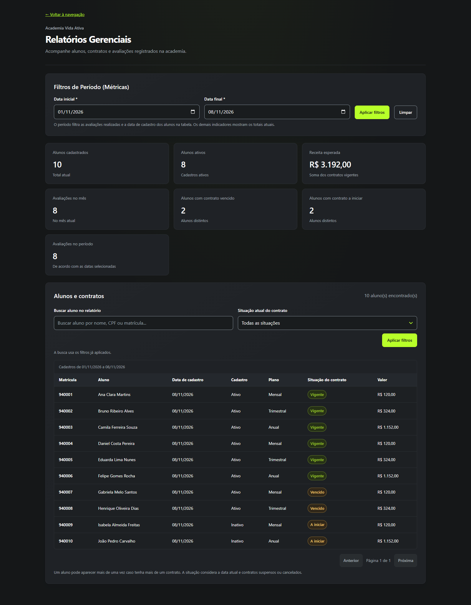
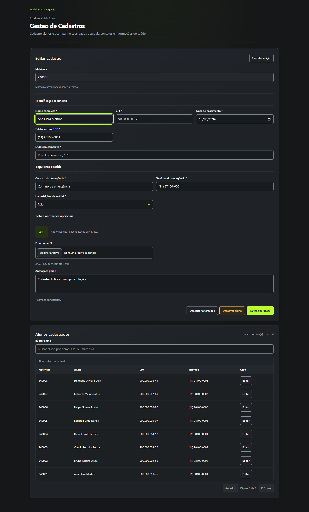
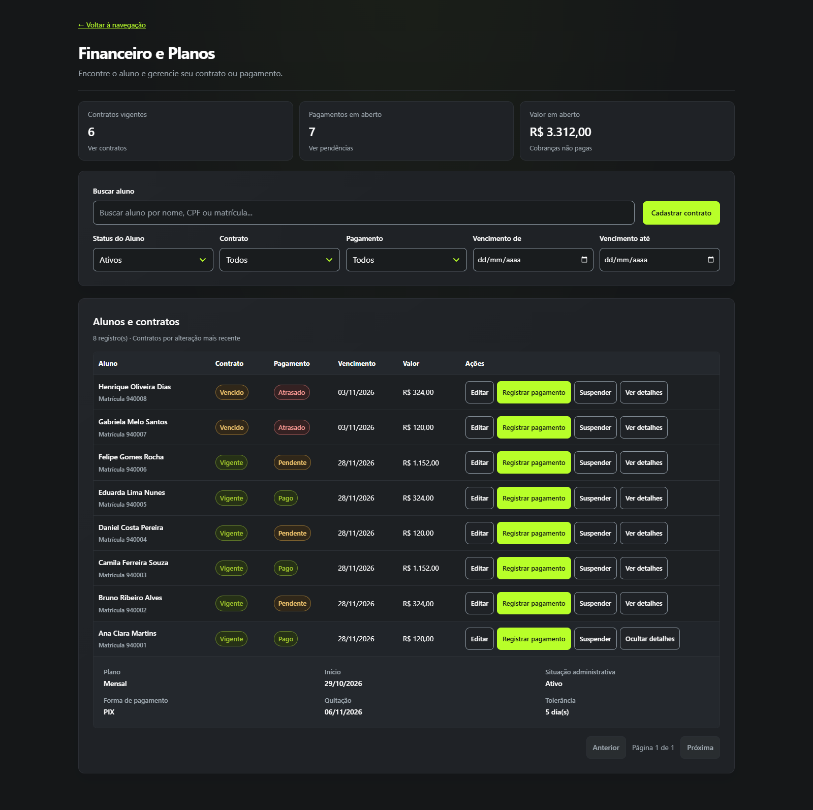
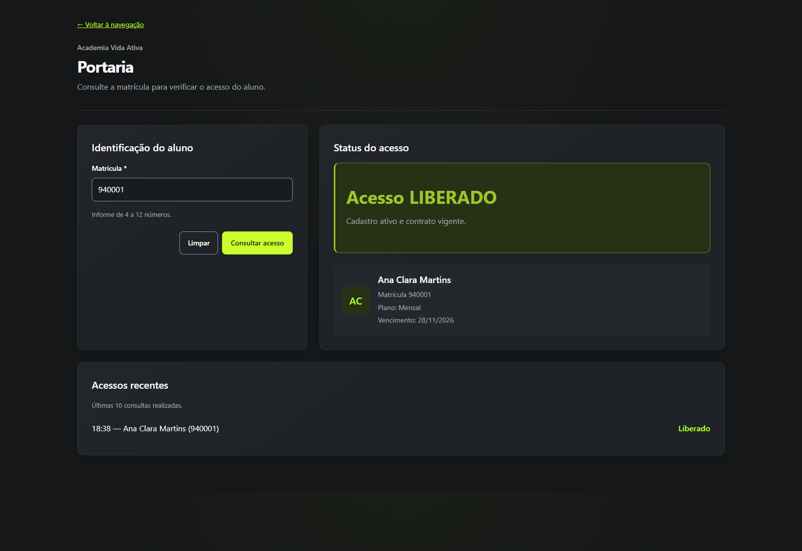
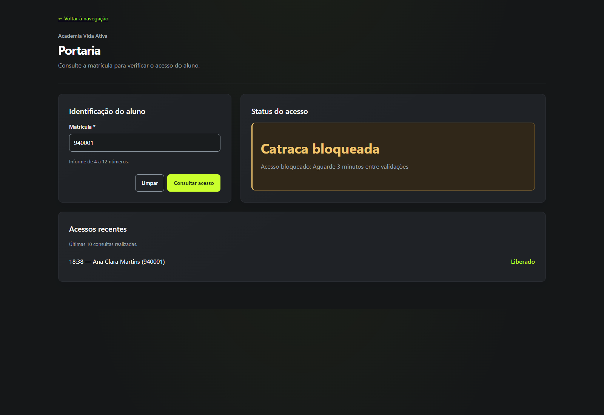
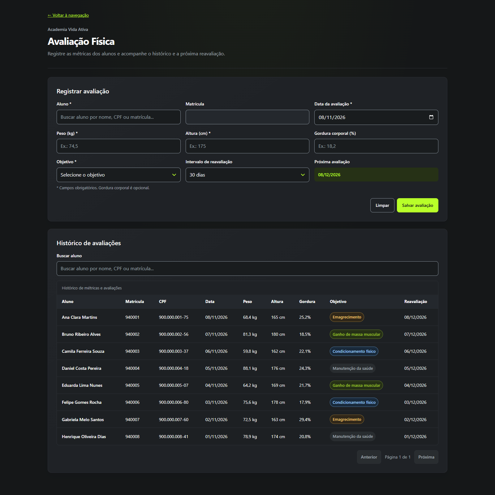

# Academia Vida Ativa

## Dossiê executivo, técnico e de apresentação comercial

**Uma operação de academia conectada, do cadastro à decisão na portaria.**

| Sobre este documento | Referência |
| --- | --- |
| Público | Integrantes do projeto, gestores de academias, recepcionistas e parceiros de negócios |
| Perspectiva | Produto, negócio e engenharia de software |
| Data da análise e das capturas | **8 de novembro de 2026** — referência de horário: America/Sao_Paulo |
| Versão apresentada | MVP fullstack executado localmente, com API e banco SQLite reais |
| Evidência visual | **6 capturas reais**, disponíveis em [`docs/prints/`](./docs/prints/) |
| Dados das imagens | Exclusivamente fictícios, provenientes do seed do projeto, em banco temporário isolado |

> **Proposta de valor:** a Academia Vida Ativa reúne o relacionamento com o aluno, seus contratos, os registros de pagamento, as avaliações físicas e a consulta de acesso em uma experiência integrada. A equipe encontra a informação no contexto da tarefa; o gestor ganha visibilidade para decidir.

**Como usar este material:** leia a seção 1 para apresentar o negócio; a seção 2 para explicar as escolhas tecnológicas; a seção 3 para defender os diferenciais; e a seção 4 para conduzir uma demonstração com imagens e falas prontas. As referências ao código permitem aprofundar as respostas sem exigir conhecimento técnico do apresentador.

**Posicionamento comercial:** o projeto demonstra fluxos reais de gestão e persistência de dados. Sua etapa atual é a de **MVP para apresentação e validação**, com trabalho adicional necessário para uma implantação comercial com autenticação, operação segura, integrações e suporte. Essa distinção ajuda a construir uma proposta confiável, com entregas e próximos passos claros.

### Navegação

- [1. Visão geral e objetivo de negócio](#visao-geral)
- [2. Stack tecnológica explicada para o cliente](#stack)
- [3. Engenharia de ponta: diferenciais e evidências](#engenharia)
- [4. Guia visual dos módulos e roteiro de apresentação](#guia-visual)

---

<a id="visao-geral"></a>

## 1. Visão geral e objetivo de negócio

### 1.1. A dor real: a informação existe, mas está espalhada

Uma academia precisa coordenar decisões que acontecem em lugares e momentos diferentes. A recepção cadastra um aluno; alguém negocia o plano; outro colaborador registra o pagamento; o profissional de educação física acompanha medidas; e a portaria precisa decidir se o acesso está autorizado.

Quando cada etapa depende de uma planilha, de anotações ou da memória de uma pessoa, surgem perguntas simples que consomem tempo: **“Este é o cadastro correto?”, “O contrato ainda está vigente?”, “O pagamento foi registrado?”, “Qual foi a última avaliação?”**. A troca de turno aumenta a dificuldade porque parte do contexto fica com quem realizou o atendimento.

O Vida Ativa organiza essas informações em torno de um mesmo aluno e de seus vínculos. O benefício central é a **continuidade da operação**: consultar, registrar e decidir usando uma base comum.

| Quem utiliza | Dificuldade cotidiana | Como a aplicação ajuda |
| --- | --- | --- |
| **Proprietário ou gestor** | Consolidar o tamanho da base, os contratos vigentes e as pendências | Painel com indicadores e consultas por período e situação |
| **Recepcionista** | Localizar alunos, evitar duplicidade e conferir informações durante o atendimento | Busca por nome, CPF ou matrícula, identificação estruturada e edição orientada |
| **Responsável financeiro** | Separar vigência contratual de pagamento e encontrar cobranças pendentes | Situações distintas para contrato e pagamento, filtros e registro de recebimento |
| **Operador da portaria** | Tomar uma decisão rápida e consistente sobre a matrícula apresentada | Resultado explícito de liberação, negativa ou bloqueio temporário |
| **Personal trainer ou avaliador** | Encontrar o histórico certo e planejar uma reavaliação | Histórico identificado por nome, matrícula e CPF, com medidas e próxima data |
| **Parceiro de negócios** | Entender o que já existe e estimar a próxima etapa | Fluxos demonstráveis, arquitetura documentada e escopo de evolução identificado |

### 1.2. O que significa ter tudo centralizado

**Centralização de identidade.** O aluno é cadastrado uma vez e passa a ser relacionado a contratos, avaliações e registros de acesso. A matrícula oferece uma referência operacional; o CPF ajuda a distinguir pessoas com nomes semelhantes.

**Centralização do contexto.** A equipe consulta informações relacionadas sem reconstruir a história do aluno a cada atendimento. No Financeiro, por exemplo, é possível localizar uma pessoa e acompanhar contrato, situação de pagamento, vencimento e ações disponíveis.

**Centralização de regras.** As decisões essenciais da Portaria são executadas na API. Desativar o aluno ou encerrar sua vigência contratual influencia a próxima consulta de acesso. O operador recebe uma resposta fundamentada, com o motivo correspondente.

**Centralização da visão gerencial.** Os relatórios usam os registros persistidos para calcular os indicadores. O painel oferece um ponto de partida para investigar contratos vencidos, base ativa e atividade de avaliação.

> **Frase para o cliente:** “A equipe passa a trabalhar com o mesmo cadastro e com o mesmo contexto. Isso reduz a necessidade de conferir informações em vários lugares antes de atender o aluno.”

### 1.3. Benefícios comerciais e operacionais

| Benefício esperado | Mecanismo presente no produto | Como medir em um piloto |
| --- | --- | --- |
| **Atendimento mais ágil** | Busca por três identificadores e ações próximas ao registro | Tempo entre localizar o aluno e concluir a tarefa |
| **Menos retrabalho** | Reutilização do cadastro em contratos e avaliações | Quantidade de correções e cadastros duplicados |
| **Cobrança mais organizada** | Identificação de pagamentos pendentes e atrasados | Tempo para localizar pendências e registrar recebimentos |
| **Maior consistência na portaria** | Regras de cadastro ativo, contrato vigente e intervalo entre consultas | Negativas justificadas, repetições bloqueadas e falhas de consulta |
| **Continuidade do histórico** | Desativação do aluno sem eliminar seus vínculos | Capacidade de consultar contratos e avaliações após a desativação |
| **Melhor acompanhamento do aluno** | Medidas organizadas por data e previsão de reavaliação | Avaliações registradas e reavaliações realizadas no prazo |
| **Menor barreira inicial de infraestrutura** | Aplicação local com SQLite e frontend estático | Esforço de instalação, manutenção e recuperação do ambiente |

Esses benefícios descrevem o potencial operacional sustentado pelas funcionalidades. **Não há, nesta versão, estudo de clientes que comprove percentuais de redução de custos, inadimplência ou aumento de retenção.** Um piloto deve estabelecer a situação inicial e acompanhar os resultados.

Para estimar ganho de tempo, pode-se usar: **atendimentos no mês × minutos economizados por atendimento ÷ 60 = horas liberadas no mês**. Os valores devem vir da observação da academia. A aplicação não calcula automaticamente esse retorno.

### 1.4. A jornada integrada que o apresentador deve conhecer

1. **Cadastrar o aluno:** registrar identificação, contato, emergência e informações complementares.
2. **Formalizar o relacionamento:** criar um contrato, escolher o plano e informar vigência e pagamento.
3. **Acompanhar a operação:** consultar pendências e ajustar o contrato ou registrar um recebimento.
4. **Consultar o acesso:** a Portaria verifica a matrícula, o cadastro e a vigência contratual.
5. **Registrar a evolução física:** associar medidas e objetivo ao aluno correto e prever a reavaliação.
6. **Consolidar a gestão:** acompanhar os indicadores e consultar os registros pelos filtros disponíveis.

O cadastro, por si só, **não cria contrato nem cobrança**. Essa separação acompanha a realidade comercial: identificar uma pessoa e vender um plano são operações diferentes.

### 1.5. Apresentação de aproximadamente um minuto

> “A Academia Vida Ativa reúne as rotinas essenciais da academia em um único sistema: cadastro, contratos, pagamentos, avaliações e consulta de acesso.
>
> Na recepção, encontramos o aluno por nome, CPF ou matrícula. No Financeiro, visualizamos contrato, vencimento e pagamento separadamente. Na Portaria, o sistema verifica cadastro ativo e contrato vigente e bloqueia novas validações da mesma matrícula durante três minutos.
>
> O gestor acompanha indicadores calculados a partir da base, enquanto o profissional de educação física consulta o histórico identificado por CPF e organiza a próxima avaliação.
>
> A versão atual funciona localmente e demonstra esses fluxos com persistência real. Ela oferece uma base concreta para um piloto e para planejar a evolução comercial com segurança, integrações e operação assistida.”

### 1.6. Respostas para perguntas frequentes de parceiros

| Pergunta | Resposta recomendada |
| --- | --- |
| **“Por que usar isso se já tenho planilhas?”** | “O valor está em relacionar informações e aplicar regras durante o atendimento. O cadastro alimenta os outros módulos, e a Portaria consulta a situação do aluno sem depender de uma conferência manual entre arquivos.” |
| **“Preciso começar pagando um servidor em nuvem?”** | “A demonstração funciona localmente, com banco SQLite. Hospedagem, rede, backup e suporte entram no dimensionamento de uma implantação comercial.” |
| **“Funciona no celular?”** | “A interface possui adaptação para telas estreitas e tabelas com rolagem horizontal. A avaliação foi conferida em uma janela de 390 pixels. O acesso de um telefone à instalação exige configurar rede e endereço da API.” |
| **“O sistema faz cobrança por PIX ou cartão?”** | “Ele registra a forma e a situação de pagamento. Processamento bancário, geração de cobrança e conciliação automática são integrações futuras.” |
| **“Já conecta com biometria ou catraca?”** | “A decisão de acesso e a proteção contra repetição já existem na API. A comunicação com um equipamento físico ainda precisa ser implementada.” |
| **“Já posso usar com dados reais de clientes?”** | “A próxima etapa é preparar a implantação, especialmente autenticação real, permissões, proteção da API e rotinas de recuperação. O login atual serve à apresentação.” |
| **“Pode crescer para uma operação maior?”** | “A organização em camadas ajuda a evolução. Hospedagem, banco, consultas e integrações precisam ser ajustados e testados conforme a escala desejada.” |

---

<a id="stack"></a>

## 2. Stack tecnológica explicada para o cliente

### 2.1. Tecnologia como decisão de negócio

A escolha tecnológica prioriza uma demonstração funcional, uma instalação local simples e um código organizado para evolução. O cliente não precisa conhecer cada ferramenta; precisa entender **qual problema ela resolve, como influencia o custo e quais responsabilidades permanecem**.

| Tecnologia | Explicação sem jargão | Por que faz sentido para o negócio | Limite que deve ser compreendido |
| --- | --- | --- | --- |
| **Node.js** | Executa a parte do sistema que recebe pedidos do navegador e coordena as operações | Permite desenvolver a API com JavaScript/TypeScript, aproximando a linguagem usada nas duas partes da aplicação | Capacidade e desempenho dependem do código, do banco, da máquina e da carga; não há benchmark de escala nesta entrega |
| **Prisma ORM** | Organiza a conversa entre o código e o banco, descrevendo alunos, contratos, avaliações e relacionamentos | Torna o acesso aos dados mais uniforme e ajuda a equipe a manter o modelo e a evoluir funcionalidades | Trocar de banco exige migração de estrutura e dados, revisão de consultas e testes |
| **SQLite** | Armazena os dados em um arquivo local, sem exigir um servidor de banco separado | Reduz a preparação da demonstração e dispensa uma hospedagem de banco para iniciar localmente | Backup, disponibilidade, concorrência e acesso de múltiplas unidades precisam ser dimensionados |
| **Vanilla JavaScript** | JavaScript executado diretamente no navegador, com HTML e CSS | O frontend pode ser servido como arquivos estáticos, sem pipeline de compilação obrigatório | A organização dos módulos e das regras compartilhadas continua necessária à medida que o produto cresce |
| **Express** | Define os caminhos pelos quais a interface solicita ou altera informações | Mantém uma API reconhecível, organizada por áreas do negócio | A API atual ainda precisa de autenticação e autorização para uma implantação comercial |
| **TypeScript** | Acrescenta descrições de tipos ao código do backend | Ajuda a equipe a entender contratos de dados e detectar inconsistências durante o desenvolvimento | Não substitui validações em execução; o comando de desenvolvimento atual usa `--transpile-only` |

O uso local e a simplicidade operacional são compatíveis com as finalidades descritas pelo próprio projeto SQLite. Para cenários que exigem um repositório compartilhado com elevada concorrência, a arquitetura deve ser reavaliada. [Referência: usos apropriados do SQLite](https://www.sqlite.org/whentouse.html).

Node.js oferece um modelo assíncrono orientado a eventos para aplicações de rede. No Vida Ativa, isso sustenta a API que recebe as solicitações dos módulos; o benefício prático é uma base comum para implementar as operações do sistema. [Referência: sobre o Node.js](https://nodejs.org/en/about).

### 2.2. Como a aplicação funciona, em linguagem simples

```text
Pessoa usando o navegador
          │
          ▼
Interface: HTML + CSS + Vanilla JavaScript
          │  solicita informações ou envia um formulário
          ▼
API: Node.js + Express + TypeScript
          │  valida dados e aplica regras de negócio
          ▼
Prisma e consultas parametrizadas
          │  consultam ou persistem os registros
          ▼
SQLite local
          │
          └──── resposta à API e atualização da tela
```

A navegação principal reúne os módulos em um `iframe`, isto é, uma área da página que carrega a tela selecionada. Os estilos e utilitários compartilhados mantêm identidade visual, formatação e padrões de interação consistentes.

No backend, as **rotas** identificam a operação, os **controllers** tratam a comunicação HTTP, os **services** concentram regras e os **repositories**, quando utilizados, encapsulam o acesso ao banco. Relatórios e Portaria também consultam o Prisma diretamente em seus serviços.

**Valor dessa separação:** uma alteração na regra de negócio pode ser localizada e revisada com mais clareza. Isso facilita entender o impacto de uma mudança antes de colocá-la em uso.

### 2.3. Os quatro grupos centrais de informação

| Registro | O que representa | Relação e utilidade |
| --- | --- | --- |
| **Aluno** | Identidade, CPF, matrícula, contatos, dados complementares e situação ativa | É o vínculo comum dos demais registros; CPF e matrícula têm restrição de unicidade no banco |
| **Contrato** | Plano, valor, início, fim, situação, tolerância e informações de pagamento | Um aluno pode ter vários contratos; a cobrança atual é representada por campos do próprio contrato |
| **Avaliação física** | Data, peso, altura, gordura opcional, objetivo e reavaliação | Um aluno pode ter várias avaliações, permitindo consulta cronológica |
| **Log de acesso** | Matrícula consultada, aluno quando encontrado, decisão, motivo e horário | Sustenta o histórico recente e o intervalo de três minutos entre validações |

No modelo persistente atual, **pagamento não é uma entidade independente com parcelas e múltiplas transações**. Forma, status e data de pagamento ficam no contrato. Essa informação é relevante ao discutir parcelamento, estornos ou conciliação como próximos incrementos.

Fontes do projeto: [`schema.prisma`](./backend/prisma/schema.prisma), [`server.ts`](./backend/src/server.ts) e [`package.json`](./backend/package.json).

### 2.4. SQLite hoje, evolução planejada amanhã

> **Argumento comercial correto:** “Começamos com uma estrutura local simples. O Prisma organiza o modelo de dados e parte do acesso ao banco, facilitando a preparação de uma evolução de infraestrutura quando houver demanda.”

Uma migração para a nuvem **não é instantânea**. É preciso escolher a hospedagem, configurar acesso seguro, preparar backup e recuperação e revisar os endereços usados pelo frontend. Se também houver troca de SQLite por outro banco, será necessário adaptar estrutura, histórico de migrações e transporte dos dados.

Há um exemplo concreto no projeto: o cooldown utiliza funções SQL do SQLite, como `julianday` e `strftime`. Essas consultas precisam ser revistas se o banco mudar. A documentação do Prisma esclarece que as migrações SQL são específicas do provedor e que a troca não transporta automaticamente os dados. [Referência: limitações de migração entre provedores](https://www.prisma.io/docs/orm/v7/prisma-migrate/understanding-prisma-migrate/limitations-and-known-issues).

O benefício do Prisma é **organização e redução de parte do esforço de evolução**, com uma base explícita para planejar a mudança.

### 2.5. O que “funcionar localmente” significa

Os arquivos da interface e a API podem operar na mesma máquina, utilizando o SQLite local. Isso permite demonstrar os fluxos sem depender de um serviço de banco externo, desde que o ambiente esteja preparado e os processos estejam em execução.

Para uma apresentação no ambiente padrão do projeto:

| Componente | Execução | Endereço padrão |
| --- | --- | --- |
| API | Na pasta `backend`, executar `npm run dev` | `http://localhost:3333` |
| Interface | Na raiz, executar `node iniciar-preview.cjs` | `http://127.0.0.1:8765/` |
| Preparação inicial | Instalar dependências, configurar o banco e executar o seed conforme o manual | [`MANUAL.md`](./MANUAL.md) |

O frontend atualmente aponta para `localhost:3333`. Em outro dispositivo, `localhost` se refere ao próprio dispositivo. Portanto, disponibilizar o sistema ao smartphone do personal exige configurar corretamente o endereço da API e a rede. **Responsividade visual e disponibilidade em rede são requisitos diferentes.**

---

<a id="engenharia"></a>

## 3. Engenharia de ponta: diferenciais e evidências

### 3.1. Soft delete: desativar o relacionamento sem destruir sua história

**Tradução:** soft delete é a exclusão lógica. Em vez de remover fisicamente o cadastro do aluno, o sistema altera sua situação para inativo.

Imagine um aluno que encerrou o relacionamento com a academia. A recepção precisa retirá-lo da rotina de alunos ativos, mas o gestor pode precisar consultar o contrato anterior ou conferir uma avaliação registrada. Eliminar o cadastro quebraria esse contexto. A desativação permite encerrar a atividade preservando as relações.

| Comportamento implementado | Valor para a academia |
| --- | --- |
| A desativação grava `ativo: false` no aluno | Retira o aluno da operação ativa sem apagar seu cadastro |
| Contratos e avaliações continuam relacionados | Preserva contexto para conferências posteriores |
| A Portaria consulta a situação ativa | Impede a liberação normal de um cadastro inativo |
| Novos contratos e avaliações exigem aluno ativo na API | Evita iniciar novas operações para um cadastro desativado |
| Contratos e avaliações usam `onDelete: Restrict` no vínculo com aluno | Acrescenta proteção contra remoção física do aluno enquanto houver esses vínculos |

**Integridade financeira:** desativar o aluno não equivale a apagar o valor, a situação ou o registro de pagamento de seus contratos. O Financeiro pode consultar alunos inativos por filtro, preservando a capacidade de conferir o relacionamento anterior.

**Apoio à auditoria:** os registros continuam disponíveis para reconstruir contexto. Isso não constitui, por si só, uma trilha completa de quem alterou cada campo, nem um histórico imutável de todas as versões.

> **Fala de apresentação:** “Encerramos a participação do aluno sem apagar a história do relacionamento. A academia conserva o contexto dos contratos e das avaliações para consultas futuras.”

**Precisão do escopo:** a política está implementada para alunos. Contratos são cancelados por mudança de situação. A API de avaliações possui exclusão física. Portanto, a frase comercial correta é **“preservamos o cadastro e seus vínculos ao desativar o aluno”**; a implementação atual não permite afirmar que nenhum dado pode ser apagado.

Evidências: [`alunoRepository.ts`](./backend/src/repositories/alunoRepository.ts), [`alunoService.ts`](./backend/src/services/alunoService.ts), [`contratoService.ts`](./backend/src/services/contratoService.ts), [`avaliacaoRepository.ts`](./backend/src/repositories/avaliacaoRepository.ts) e [`schema.prisma`](./backend/prisma/schema.prisma).

### 3.2. Anti-passback: três minutos de proteção contra validações repetidas

**Tradução:** o cooldown é um intervalo obrigatório entre consultas da mesma matrícula. Ele funciona como uma forma temporal de anti-passback, dificultando o uso repetido da mesma identificação em sequência.

O problema operacional é concreto: uma carteirinha pode ser apresentada duas vezes em poucos segundos, e um leitor integrado futuramente pode transmitir várias leituras de um único evento. Sem controle, o sistema poderia interpretar cada repetição como uma nova decisão independente.

**A implementação atual consulta o histórico persistido e rejeita uma nova validação da mesma matrícula durante a janela de três minutos.** O controle é feito no backend; recarregar a página não elimina o registro no banco.

#### Como a regra funciona

1. A API valida o formato da matrícula: entre 4 e 12 dígitos.
2. Procura uma consulta registrada para a mesma matrícula nos últimos três minutos.
3. Se encontrar, retorna **HTTP 429** e a mensagem de bloqueio.
4. Se não encontrar, verifica o aluno, sua situação e um contrato elegível.
5. Registra a decisão com matrícula, motivo e horário, repetindo a condição de ausência de consulta recente dentro da própria inserção SQL.
6. Se outra requisição tiver registrado primeiro, a inserção não ocorre e a consulta concorrente também recebe 429.

| Situação | Resultado HTTP | O que a interface apresenta |
| --- | --- | --- |
| Cadastro ativo e contrato elegível, sem consulta recente | `200` | **Acesso LIBERADO**, motivo e identificação do aluno |
| Matrícula desconhecida, aluno inativo ou ausência de contrato elegível | `200` | **Acesso NEGADO**, com motivo de negócio |
| Mesma matrícula consultada dentro da janela de três minutos | `429` | **Catraca bloqueada**, em amarelo, com orientação de espera |
| Matrícula em formato inválido | `400` | Mensagem para corrigir a matrícula |
| Falha de comunicação com a API | Sem decisão válida de liberação | Mensagem de erro; a tela não deve ser interpretada como autorização |

```http
HTTP/1.1 429 Too Many Requests
Cache-Control: no-store
Content-Type: application/json

{"erro":"Acesso bloqueado: Aguarde 3 minutos entre validações"}
```

O código HTTP 429 comunica que o limite de solicitações foi excedido. Neste produto, ele foi associado ao intervalo por matrícula, permitindo que a interface diferencie esse caso de uma negativa contratual ou de uma falha do servidor. [Referência: HTTP 429](https://developer.mozilla.org/en-US/docs/Web/HTTP/Reference/Status/429).

#### Por que isso é um diferencial demonstrável

- **Dificulta a reutilização imediata da identificação:** uma segunda consulta não recebe uma nova liberação durante a janela.
- **Prepara a regra para repetição de leitores:** se um equipamento vier a chamar essa API, sua integração poderá reconhecer o 429 e evitar tratar a repetição como novo acesso.
- **Resiste a chamadas concorrentes:** a condição é verificada na inserção, além da consulta inicial. O teste de integração aprovou um cenário com oito chamadas simultâneas, resultando em uma resposta 200 e sete respostas 429.
- **Persiste fora do navegador:** o histórico utilizado pela regra fica no SQLite.
- **Evita histórico duplicado por cooldown:** a repetição bloqueada não insere um novo log de acesso.

> **Fala de apresentação:** “Mesmo que a mesma matrícula seja consultada novamente logo depois, o servidor reconhece a repetição e pede um intervalo de três minutos. A regra continua valendo se a tela for recarregada.”

#### Limites que tornam a explicação tecnicamente correta

O intervalo vale para consultas anteriores **liberadas ou negadas**, incluindo matrícula inexistente que tenha sido registrada. Uma correção de contrato logo após uma negativa não elimina automaticamente a espera. Repetições que recebem 429 não reiniciam o prazo, pois não geram um novo log.

A regra reduz a repetição imediata, mas **não comprova a identidade de quem apresenta a matrícula** e não controla entrada e saída física. Não existe integração biométrica, leitura de carteirinha ou acionamento de catraca nesta versão. A mensagem “Catraca bloqueada” descreve o resultado da interface.

A consulta usa um endpoint `GET`, mas grava um log. Ela, portanto, não é uma operação estritamente de leitura. Essa particularidade deve ser considerada numa evolução de integrações e da semântica da API.

Evidências: [`portariaService.ts`](./backend/src/services/portariaService.ts), [`portariaRoutes.ts`](./backend/src/routes/portariaRoutes.ts), [`script.js` da Portaria](./modulos/modulo-03-portaria/script.js) e [`portaria-integration.test.cjs`](./tests/portaria-integration.test.cjs).

### 3.3. Design responsivo: preservar a informação em telas menores

Uma tabela de avaliações reúne nome, matrícula, CPF, data, peso, altura, gordura, objetivo e reavaliação. Comprimir todas essas colunas na largura de um telefone prejudicaria a leitura. O projeto preserva a estrutura da tabela e permite **rolagem horizontal dentro de sua própria área**.

| Decisão de interface | Benefício de uso | Evidência técnica |
| --- | --- | --- |
| Tabelas em contêiner com rolagem horizontal | O avaliador pode percorrer as colunas sem comprimir todos os dados | `.table-wrap` com `overflow-x: auto` |
| Largura mínima baseada no conteúdo | Valores, datas e identificadores mantêm legibilidade | `table` com `min-width: max-content` |
| Formulários reorganizados em telas estreitas | Campos ficam dispostos verticalmente para facilitar preenchimento | Media queries e grids que passam a uma coluna |
| Botões e campos com altura adequada ao toque | Facilita selecionar ações e preencher informações | Controles principais com altura mínima de 46 pixels; ações compactas de 44 pixels |
| Texto junto às cores de situação | Permite entender o resultado sem depender apenas da cor | Etiquetas como “Pago”, “Pendente” e “Vencido” |
| Foco visível, rótulos e áreas de status | Ajuda a navegação por teclado e a identificação dos campos | `:focus-visible`, labels, `role="status"` e `aria-live` |
| Respeito à preferência de movimento reduzido | Diminui animações quando o usuário solicita | `prefers-reduced-motion` |

**Verificação realizada:** no histórico de avaliações, em viewport de **390 × 844 pixels**, a página manteve largura de 390 pixels. A área da tabela possuía 318 pixels visíveis e 971 pixels de conteúdo, com rolagem horizontal efetivamente verificada. Os prints principais foram capturados com largura de 1600 pixels.

> **Fala de apresentação:** “No celular, o profissional percorre as colunas do histórico dentro da própria tabela. O CPF e as medidas continuam organizados, e o formulário se adapta à largura da tela.”

Isso demonstra a adaptação no cenário verificado. Uma homologação ampla em diferentes aparelhos, navegadores e tecnologias assistivas permanece parte da preparação comercial; não se afirma funcionamento perfeito em todo dispositivo.

Evidências: [`assets/app.css`](./assets/app.css), [`style.css` do Financeiro](./modulos/modulo-02-financeiro/style.css) e [`index.html` das Avaliações](./modulos/modulo-05-avaliacao/index.html).

### 3.4. Outros cuidados de engenharia que geram confiança

| Cuidado | Efeito percebido pelo usuário | Escopo real |
| --- | --- | --- |
| **CPF e matrícula únicos no banco** | Reduz duplicações e ambiguidades de identidade | O backend verifica o formato de 11 dígitos do CPF; a interface também valida seus dígitos verificadores |
| **Validação de avaliações no frontend e na API** | Orienta a correção antes de salvar e rejeita medidas fora das faixas aceitas | Peso: 20–350 kg; altura: 50–250 cm; gordura opcional: 2–70%; datas também são validadas |
| **Identificação por CPF no histórico** | Distingue alunos homônimos | CPF formatado e busca por nome, CPF ou matrícula |
| **Resumo antes de salvar no Financeiro** | Permite conferir o que será registrado ou alterado | A edição destaca diferenças em relação aos valores anteriores |
| **Proteção contra perda de edição** | Solicita confirmação ao abandonar alterações não salvas | Diálogos da aplicação e proteção de navegação do formulário |
| **Paginação** | Torna listas mais fáceis de percorrer | A divisão em páginas é feita na interface; não equivale a paginação de banco |
| **Respostas antigas descartadas** | Evita que uma consulta anterior sobrescreva uma mais recente em fluxos implementados | Controles de versão de requisições em módulos como Relatórios e Portaria |
| **Renderização de dados como texto** | Evita interpretar nomes e outros conteúdos inseridos como HTML nesses renderizadores | Uso de criação de elementos e `textContent`; há testes específicos |
| **Erros comunicados na tela** | Permite reconhecer indisponibilidade ou dados inválidos | Fluxos integrados não substituem uma falha da API por dados fictícios silenciosamente |

As faixas de avaliação são **regras de entrada do software**, não interpretação clínica. O módulo organiza informações; não prescreve treino ou emite diagnóstico.

### 3.5. Leitura técnica dos indicadores e das decisões

Para apresentar bem, é essencial saber o que cada número significa.

| Conceito | Regra atual | Interpretação correta |
| --- | --- | --- |
| **Receita esperada dos Relatórios** | Soma do valor integral dos contratos classificados como vigentes | Carteira contratual vigente; não é receita mensal recorrente, caixa recebido ou lucro |
| **Valor em aberto do Financeiro** | Soma dos valores dos contratos cujo pagamento não está marcado como Pago | Montante de cobranças não pagas representadas na base; não apenas valores já vencidos |
| **Alunos ativos** | Contagem de cadastros com `ativo = true` | Cadastro ativo não significa necessariamente contrato vigente ou pagamento quitado |
| **Alunos com contrato vencido** | Contagem distinta de alunos que possuem contrato classificado como vencido | Um aluno pode ter outro contrato vigente; o número não é uma lista exclusiva de pessoas sem acesso |
| **Avaliações no período** | Contagem pela data da avaliação dentro do intervalo selecionado | Volume de registros realizados no intervalo |
| **Lista de alunos dos Relatórios** | Filtrada pela data de criação do cadastro, com busca e situação contratual | O filtro de período não significa que todos os indicadores sejam históricos daquele período |
| **Liberação na Portaria** | Cadastro ativo e contrato com situação armazenada Vigente/Ativo, iniciado e ainda não encerrado | A Portaria não consulta diretamente status de pagamento nem aplica os dias de tolerância |

A diferença entre vigência e pagamento merece atenção: um contrato vigente com pagamento pendente pode ser liberado pela regra atual. **Não se deve apresentar o MVP como um bloqueador automático de toda inadimplência.** Uma política desse tipo exige alinhar a regra da Portaria com a cobrança e a tolerância desejadas pelo negócio.

Evidências: [`relatorioService.ts`](./backend/src/services/relatorioService.ts), [`script.js` do Financeiro](./modulos/modulo-02-financeiro/script.js) e [`portariaService.ts`](./backend/src/services/portariaService.ts).

### 3.6. Escopo atual e evolução para uma oferta comercial

| Área | Entrega atual | Próxima evolução a dimensionar |
| --- | --- | --- |
| Identidade e permissões | Login simulado, com credenciais no frontend e navegação por perfil | Autenticação real e permissões verificadas no servidor |
| API | Operações integradas por HTTP, sem autenticação | Controle de acesso, configuração por ambiente e proteção dos endpoints |
| Histórico | Dados persistidos, soft delete de alunos e logs de consultas da Portaria | Rastreabilidade de alterações com autoria, política de retenção e recuperação |
| Liberação excepcional | Módulo de Liberação e Auditoria baseado em estado local de demonstração | Integração com a API e com a decisão real da Portaria |
| Pagamentos | Registro manual de forma, situação e data no contrato | Cobrança, conciliação, parcelamento e integração com provedores |
| Equipamentos | Consulta de acesso por matrícula | Integração e homologação com catracas, leitores ou biometria |
| Banco e disponibilidade | SQLite local | Backup verificado, restauração, monitoramento e infraestrutura conforme demanda |
| Evolução de schema | Schema atual inclui `LogAcesso`; migrações versionadas ainda não incluem essa tabela | Regularização do histórico de migrações antes de automatizar implantações |
| Escala | Listagens e parte das agregações processam conjuntos completos de registros | Medição de carga, paginação no servidor e otimização de consultas |
| Valores financeiros | Valor do contrato armazenado como `Float`, com conversões para apresentação | Revisão de representação monetária e consistência para operação financeira ampliada |

**Sequência de produto sugerida:** consolidar acesso e operação segura; validar um piloto com regras comerciais acordadas; integrar os serviços prioritários; medir carga e então dimensionar a expansão. Essa sequência é uma proposta de evolução, sem prazos ou funcionalidades prometidas como já entregues.

---

<a id="guia-visual"></a>

## 4. Guia visual dos módulos e roteiro de apresentação

As imagens abaixo foram capturadas da aplicação em execução, com respostas do backend real. Os módulos foram abertos em sua página completa para mostrar o conteúdo sem o recorte da área de navegação. **Os dados são fictícios e não representam faturamento ou alunos de uma academia real.**

### 4.1. Dashboard de Relatórios Gerenciais



**Propósito da tela:** oferecer uma visão consolidada da base, dos contratos e da atividade de avaliações, permitindo partir de um indicador para uma consulta mais detalhada.

#### O que o cliente está vendo

| Elemento da imagem | O que explicar |
| --- | --- |
| Filtros de período | Delimitam as avaliações do período e a data de cadastro dos alunos na tabela |
| Alunos cadastrados e ativos | Mostram o tamanho atual da base e quantos cadastros estão ativos |
| Receita esperada | Soma dos valores integrais dos contratos vigentes |
| Contratos vencidos e a iniciar | Ajudam a identificar grupos que merecem acompanhamento |
| Avaliações no mês e no período | Evidenciam o volume de registros de avaliação |
| Busca e situação contratual | Permitem localizar alunos e investigar tipos de contrato |
| Tabela com paginação | Relaciona aluno, matrícula, cadastro, plano, situação e valor |

**Leitura dos números desta captura:** são **10 alunos**, dos quais **8 ativos**, **R$ 3.192,00** em contratos vigentes, **8 avaliações** no mês, **2 alunos com contrato vencido** e **2 com contrato a iniciar**. Esses valores demonstram a base fictícia no momento da captura e mudam quando os dados ou as datas mudam.

**Destaques para mencionar:** os indicadores vêm do backend; o período tem seu alcance explicado na própria tela; a busca aceita nome, CPF ou matrícula; e as situações aparecem com texto e cores. Um aluno pode aparecer em mais de uma linha se possuir vários contratos.

**Demonstração em três movimentos:** apresente os indicadores, localize “Ana Clara” na busca e aplique uma situação contratual para mostrar como a lista pode apoiar uma investigação gerencial.

> **Fala pronta:** “Este painel transforma os registros da operação em uma visão de gestão. Ele mostra o tamanho da base, a carteira vigente e os grupos de contratos que precisam de atenção. A partir daqui, podemos localizar o aluno e entender seu contexto.”

**Cuidado de apresentação:** o valor de R$ 3.192,00 não é dinheiro recebido no mês. Os cards gerais também não passam a representar exclusivamente os resultados filtrados da tabela.

### 4.2. Gestão de Cadastros



**Propósito da tela:** construir e manter a referência central do aluno, com identificação, contato, emergência e informações complementares.

A captura mostra **Ana Clara Martins em modo de edição**, com matrícula 940001, campos preenchidos e a ação “Desativar aluno” disponível. Abrir o cadastro para consulta não modifica seus dados.

| Área | Destaque de usabilidade ou integridade |
| --- | --- |
| Matrícula | Gerada automaticamente na criação; apresentada como somente leitura na edição |
| Identificação e contato | Nome, CPF, nascimento, telefone e endereço agrupados por finalidade |
| Segurança e saúde | Contato de emergência e indicação de restrições organizados no mesmo cadastro |
| Foto e anotações | Informações complementares sem confundir os campos obrigatórios |
| Desativação | Encerra a atividade do cadastro preservando seus relacionamentos |
| Lista de alunos ativos | Busca por nome, CPF ou matrícula, paginação e acesso direto à edição |

**Destaque comercial:** a recepção não precisa recadastrar a pessoa para iniciar um contrato ou registrar uma avaliação. Os outros módulos localizam o aluno já existente.

**Demonstração em três movimentos:** busque a matrícula, abra “Editar” e mostre a ação de desativação explicando seus efeitos. Para demonstrar uma desativação efetiva, use um cadastro fictício dedicado à apresentação e confira os impactos nos demais módulos.

> **Fala pronta:** “Este é o ponto de origem do relacionamento com o aluno. A identificação fica organizada, a equipe encontra a pessoa por diferentes referências e, quando necessário, pode desativá-la preservando o histórico relacionado.”

**Precisão para dúvidas técnicas:** a matrícula é preservada pela interface de edição, mas não é imutável em toda a API. A prevenção de CPF duplicado é sustentada pelo serviço e pela restrição no banco.

**Sobre a foto:** o cadastro permite armazená-la, mas a Portaria integrada atual usa um avatar com iniciais e não recebe a foto nessa consulta. A indicação da interface sobre foto na catraca não deve ser vendida como integração já concluída.

### 4.3. Financeiro e Planos



**Propósito da tela:** organizar contratos e registros de pagamento em torno do aluno, com uma consulta inicial clara e operações abertas conforme a necessidade.

A imagem mostra **6 contratos vigentes**, **7 pagamentos em aberto** e **R$ 3.312,00 em valores não pagos** na base fictícia. A listagem está filtrada para alunos ativos, enquanto os indicadores representam os totais gerais. Os detalhes do contrato de Ana Clara estão expandidos para mostrar plano, início, forma de pagamento, quitação e tolerância cadastrada.

| Recurso | Como explicar ao cliente |
| --- | --- |
| Indicadores clicáveis | “Contratos vigentes” e “Pagamentos em aberto” ajudam a aplicar filtros rapidamente |
| Filtros combinados | Status do aluno, contrato, pagamento e intervalo de vencimento ajudam a encontrar a demanda |
| Contrato separado de pagamento | Um contrato pode estar vigente e ainda ter pagamento pendente; os estados são apresentados separadamente |
| Registrar pagamento | Abre uma operação específica para informar a quitação da cobrança existente |
| Editar | Permite revisar contrato e pagamento com resumo das alterações |
| Suspender e reativar | Permite tratar a pausa administrativa, com saldo de dias na lógica implementada |
| Ver detalhes | Expande informações secundárias sem exigir uma edição |
| Cadastrar contrato | Inicia uma nova operação para um aluno cadastrado; abrir o painel não grava a contratação |

#### Planos presentes na configuração de demonstração

| Plano | Duração configurada para novo contrato | Valor total configurado |
| --- | --- | ---: |
| Mensal | 1 mês | R$ 120,00 |
| Trimestral | 3 meses | R$ 324,00 |
| Anual | 12 meses | R$ 1.152,00 |

Esses são **preços de exemplo do projeto**, não uma proposta comercial de licença do software. O formulário calcula o vencimento conforme plano e início, com possibilidade de ajuste. O seed utiliza datas simplificadas para representar situações distintas; as vigências dos registros das imagens não servem como exemplo de duração contratual de cada plano.

**Destaque de confiabilidade:** o resumo permite conferir os dados antes de salvar. O fluxo de pagamento preserva os demais dados contratuais sob as regras implementadas, e o backend valida valores, datas e situações aceitas.

**Demonstração em quatro movimentos:** use “Pagamentos em aberto”, localize um aluno, abra “Ver detalhes” e mostre o painel “Registrar pagamento”, explicando a conferência antes da confirmação. Faça gravações apenas na base de demonstração preparada para isso.

> **Fala pronta:** “Esta tela separa duas perguntas que precisam de respostas diferentes: o contrato está vigente e o pagamento está registrado? Assim, a equipe encontra pendências, confere o contexto e executa a operação adequada com menos ambiguidade.”

**Cuidado de apresentação:** selecionar PIX, cartão, dinheiro ou boleto registra a forma informada. O sistema não transfere dinheiro, não emite boleto e não confirma liquidação bancária. A tolerância exibida também não é aplicada pela Portaria integrada atual.

### 4.4. Portaria: acesso liberado



**Propósito da tela:** transformar uma matrícula em uma decisão de acesso compreensível para o operador.

O caso demonstrado é o da matrícula **940001**, vinculada a **Ana Clara Martins**. A tela apresenta **“Acesso LIBERADO”**, informa o motivo **“Cadastro ativo e contrato vigente”** e mostra plano e vencimento.

| Elemento | Destaque a mencionar |
| --- | --- |
| Campo único de matrícula | Simplifica a tarefa de consulta na portaria |
| Resultado em destaque | Texto e cor ajudam a reconhecer rapidamente a decisão |
| Motivo da liberação | Explica a regra aplicada, reduzindo interpretação informal |
| Identificação e plano | Permitem conferir o aluno associado à matrícula |
| Acessos recentes | Exibem as últimas dez consultas registradas, com horário e situação |

**Demonstração em três movimentos:** informe 940001, consulte e aponte o resultado, o motivo e o novo registro no histórico. A demonstração exige que essa matrícula não tenha uma consulta dentro dos três minutos anteriores.

> **Fala pronta:** “A recepção apresenta a matrícula, e o servidor verifica se o cadastro está ativo e se há um contrato elegível no período atual. O operador recebe uma decisão acompanhada de motivo e identificação.”

**Destaque de escopo:** a resposta da Portaria não inclui CPF, telefone ou informações de saúde. A API geral, entretanto, ainda não possui autenticação; a redução de campos dessa resposta não equivale a uma política completa de controle de acesso.

### 4.5. Portaria: bloqueio de segurança por cooldown



**Propósito deste estado:** comunicar que uma repetição recente foi interceptada pela regra de três minutos.

Esta captura usa a **mesma matrícula 940001** após a consulta anterior. O resultado é **“Catraca bloqueada”**, com a mensagem **“Acesso bloqueado: Aguarde 3 minutos entre validações”**. A resposta real da API foi **HTTP 429**.

| O que muda | Por que importa |
| --- | --- |
| Painel muda para amarelo | Diferencia a espera temporária de uma liberação ou negativa comum |
| Mensagem informa o intervalo | O operador sabe o motivo da interrupção |
| Cartão do aluno anterior fica oculto | Evita confundir uma identificação de consulta anterior com o resultado atual |
| Histórico continua com o registro anterior | A repetição por cooldown não foi gravada como outro acesso |

**Demonstração recomendada:** faça esta etapa imediatamente após a liberação, consultando a mesma matrícula. Explique que o bloqueio foi decidido no servidor e que não basta atualizar o navegador para removê-lo.

> **Fala pronta:** “Ao repetir a consulta, o sistema identifica a tentativa dentro da janela de segurança. Ele evita uma nova validação imediata e orienta o operador a aguardar. Esse é o controle temporal que pode apoiar uma futura integração com leitores.”

**Pergunta provável:** “Isso elimina toda fraude de carteirinha?” **Resposta:** “Ele dificulta a reutilização imediata da mesma matrícula. A confirmação de identidade e o controle físico do equipamento dependem de mecanismos adicionais.”

### 4.6. Avaliação Física e histórico identificado por CPF



**Propósito da tela:** registrar medidas de forma estruturada, consultar o histórico do aluno correto e organizar a próxima reavaliação.

A captura mostra o formulário e **oito avaliações fictícias** no histórico. A coluna **CPF** está visível entre matrícula e data, permitindo distinguir alunos mesmo quando seus nomes são semelhantes.

| Recurso | Valor para o profissional e para a academia |
| --- | --- |
| Seleção de aluno existente | Vincula a avaliação à mesma identidade utilizada na gestão |
| Matrícula preenchida pelo vínculo | Ajuda a conferir a pessoa selecionada |
| Peso, altura e gordura opcional | Padroniza os campos registrados e suas unidades |
| Objetivo com etiquetas textuais | Facilita reconhecer a finalidade do acompanhamento |
| Intervalo de 30, 45, 60 ou 90 dias | Calcula a próxima data a partir da avaliação |
| Histórico com CPF | Reduz a ambiguidade entre homônimos |
| Busca por nome, CPF ou matrícula | Ajuda a localizar o conjunto relevante de avaliações |
| Paginação e rolagem horizontal | Permitem percorrer registros e colunas em diferentes larguras de tela |

**Destaque de integridade:** a API rejeita avaliações futuras, reavaliações anteriores à avaliação, medidas fora das faixas aceitas e criação de avaliação para aluno inativo. Também verifica a relação da data com o nascimento quando informado.

**Demonstração em quatro movimentos:** aponte a coluna CPF, busque `900.000.001-75`, confira a identificação de Ana Clara e mostre como a data prevista depende do intervalo de reavaliação. Na captura, o formulário em 08/11/2026 com intervalo de 30 dias apresenta **08/12/2026**.

> **Fala pronta:** “O acompanhamento fica associado à pessoa correta. Além do nome e da matrícula, o histórico exibe CPF, medidas, objetivo e reavaliação. O profissional consegue localizar os registros e planejar a continuidade do atendimento.”

**Precisão de escopo:** a próxima data é calculada e registrada; o produto não envia lembretes automáticos nem apresenta um gráfico de evolução nessa tela. O conteúdo auxilia o acompanhamento profissional sem realizar diagnóstico.

### 4.7. Roteiro integrado para uma apresentação de 6 a 8 minutos

| Etapa | Tempo sugerido | Ação e mensagem principal |
| --- | --- | --- |
| Abertura | 45 segundos | Apresente a dor da informação espalhada e a proposta de centralização |
| Relatórios | 1 minuto | Mostre os indicadores e esclareça o significado de receita esperada |
| Cadastros | 1 minuto | Localize Ana Clara, mostre a identidade comum e explique a desativação |
| Financeiro | 1 a 2 minutos | Diferencie contrato e pagamento, abra detalhes e explique a conferência antes de salvar |
| Portaria liberada | 45 segundos | Consulte a matrícula e explique a decisão com motivo |
| Portaria bloqueada | 45 segundos | Repita imediatamente e demonstre o cooldown de três minutos |
| Avaliação física | 1 minuto | Mostre CPF, medidas, busca e previsão de reavaliação |
| Próximo passo | 30 segundos | Proponha validar a rotina da academia e dimensionar a preparação do piloto |

No login administrativo atual, a primeira tela indicada pelo fluxo de entrada é Cadastros; selecione **Relatórios Gerenciais** no menu para seguir esse roteiro. A Portaria possui um perfil de demonstração próprio. As credenciais e a preparação do ambiente estão no [`Manual Operacional`](./MANUAL.md).

**Prepare antes de apresentar:** confirme que a API responde, que a base é de demonstração, que a matrícula escolhida tem contrato elegível na data atual e que o cooldown expirou. Tenha este dossiê disponível para explicar os estados capturados caso não seja conveniente aguardar a janela durante a reunião.

### 4.8. Um módulo adicional que deve ser apresentado com contexto

A navegação também inclui **Liberação e Auditoria**. Ele demonstra o conceito de autorização excepcional com justificativa, responsável, validade e histórico em armazenamento local do navegador.

**Esse módulo ainda não está integrado à API da Portaria.** Suas autorizações não desbloqueiam a consulta real apresentada nos prints. Por isso, ele pode ser citado como uma direção de produto, mas não deve ser usado para prometer liberação excepcional operacional já conectada ao backend.

É importante distinguir dois recursos: **os logs da Portaria já são persistidos no SQLite; o módulo separado de Liberação e Auditoria utiliza dados locais de demonstração.**

### 4.9. Registro de evidências e qualidade da entrega

#### Imagens entregues

| Arquivo | Estado comprovado pela imagem | Dimensão |
| --- | --- | --- |
| [`relatorios.png`](./docs/prints/relatorios.png) | Indicadores preenchidos e tabela de alunos e contratos | 1600 × 2052 px |
| [`cadastros.png`](./docs/prints/cadastros.png) | Cadastro fictício em edição e lista de alunos ativos | 1600 × 2646 px |
| [`financeiro.png`](./docs/prints/financeiro.png) | Indicadores, filtros, contratos e detalhes expandidos | 1600 × 1594 px |
| [`portaria.png`](./docs/prints/portaria.png) | Acesso liberado, aluno e consulta registrada | 1600 × 1100 px |
| [`portaria-bloqueada.png`](./docs/prints/portaria-bloqueada.png) | Bloqueio por cooldown e mensagem de três minutos | 1600 × 1100 px |
| [`avaliacao.png`](./docs/prints/avaliacao.png) | Histórico preenchido com coluna CPF visível | 1600 × 1601 px |

#### Como as capturas foram produzidas

A interface foi servida localmente em `http://127.0.0.1:8766/`. Uma instância separada do backend foi iniciada em `http://localhost:3334`, conectada a um SQLite temporário contendo somente os registros fictícios do [`seed.ts`](./backend/prisma/seed.ts). A estrutura foi reproduzida a partir do banco local, sem copiar seus registros.

As imagens foram obtidas no Chrome com Playwright, em página completa. As chamadas que o frontend faz para a porta padrão 3333 foram encaminhadas, no navegador de captura, para o backend isolado na porta 3334. **As respostas vieram da aplicação real; não foram fabricados resultados de API nem alterados textos das telas para compor as imagens.**

Os registros já existentes no banco de trabalho foram preservados. As imagens documentam a versão analisada; não são protótipos desenhados ou montagens de interface.

#### Verificações executadas

| Verificação | Resultado | O que comprova |
| --- | --- | --- |
| Abertura dos módulos com backend real | Concluída | Telas e listas carregaram com os dados fictícios persistidos |
| Revisão visual dos seis PNGs | Concluída | Conteúdo legível, estados correspondentes e CPF visível na avaliação |
| Repetição de matrícula na Portaria | HTTP 429 observado | O bloqueio apresentado corresponde à resposta real do backend |
| `node tests/front-end.test.cjs` | **91 de 91 cenários aprovados** | Comportamentos de interface e utilitários cobertos pela suíte existente |
| `node tests/portaria-integration.test.cjs` | **Aprovado em banco isolado** | Regras de acesso, logs, cooldown, concorrência e ligação da interface com a API |
| Histórico em 390 × 844 px | **Rolagem horizontal verificada** | Página sem extravasamento horizontal global e tabela rolável |

O teste de Portaria foi direcionado ao ambiente temporário pelas variáveis `PORTARIA_TEST_URL` e `PORTARIA_TEST_DB`. A suíte de frontend inclui também comportamentos locais de demonstração; sua aprovação não significa que todos eles estejam integrados à API. Não foram executadas nesta entrega as demais suítes de integração de Financeiro, Relatórios e Avaliações, nem ensaios de carga ou uma auditoria de segurança completa.

### 4.10. Referências para aprofundamento

| Tema | Onde consultar |
| --- | --- |
| Preparação do ambiente | [`MANUAL.md`](./MANUAL.md) |
| Visão do repositório | [`README.md`](./README.md) |
| Modelo de dados e relacionamentos | [`backend/prisma/schema.prisma`](./backend/prisma/schema.prisma) |
| Regras da Portaria | [`backend/src/services/portariaService.ts`](./backend/src/services/portariaService.ts) |
| Desativação de alunos | [`backend/src/repositories/alunoRepository.ts`](./backend/src/repositories/alunoRepository.ts) |
| Contratos e pagamentos | [`backend/src/services/contratoService.ts`](./backend/src/services/contratoService.ts) |
| Validação das avaliações | [`backend/src/services/avaliacaoService.ts`](./backend/src/services/avaliacaoService.ts) |
| Cálculo dos indicadores | [`backend/src/services/relatorioService.ts`](./backend/src/services/relatorioService.ts) |
| Padrões visuais e responsividade | [`assets/app.css`](./assets/app.css) |
| Testes utilizados | [`tests/front-end.test.cjs`](./tests/front-end.test.cjs) e [`tests/portaria-integration.test.cjs`](./tests/portaria-integration.test.cjs) |

**Organização da documentação:** o README apresenta o produto e o Quick Start; o Manual detalha a operação; este dossiê reúne a argumentação comercial, as evidências visuais e a análise técnica. A Portaria registra consultas no banco e aplica cooldown, conforme a versão analisada.

> **Mensagem para encerrar a apresentação:** “O Vida Ativa já permite demonstrar uma operação conectada, com dados persistidos e regras verificáveis. O próximo passo é aplicar essa base à rotina da academia, acordar os critérios do piloto e preparar a implantação comercial conforme a necessidade do negócio.”
