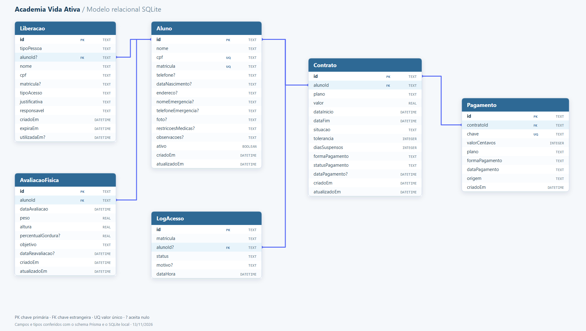
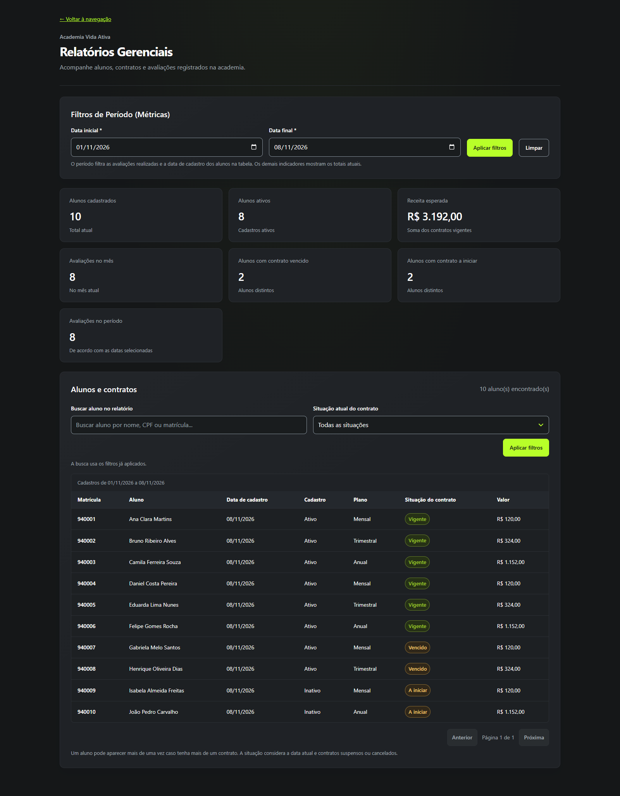

<p align="center">
  
</p>

# Academia Vida Ativa

**Uma academia conectada: alunos, contratos, pagamentos, avaliações e decisões de acesso em uma única experiência de gestão.**

**MVP v1.0** · Aplicação fullstack · Persistência local · Interface responsiva

O Vida Ativa moderniza a rotina da academia ao transformar informações dispersas em uma operação integrada. A recepção encontra o aluno, o financeiro acompanha contratos e pagamentos, o avaliador consulta o histórico e a portaria recebe uma decisão de acesso com motivo explícito. Para o gestor, relatórios consolidam os registros e ajudam a identificar o que precisa de atenção.

Este repositório entrega um **MVP funcional para demonstração e avaliação**, com frontend conectado a uma API e dados persistidos em SQLite.

[Quick Start](#quick-start) · [Credenciais](#acesso-e-credenciais) · [Dossiê executivo](./DOSSIE_EXECUTIVO.md) · [Manual operacional](./MANUAL.md)

## O que o sistema entrega

| Módulo | Funcionalidades principais |
| --- | --- |
| **Gestão de Cadastros** | Cadastro e edição de alunos, matrícula automática, busca por nome/CPF/matrícula, paginação e desativação com preservação dos vínculos |
| **Financeiro e Planos** | Contratos, vigência, planos, registro de pagamento, filtros combinados, suspensão e reativação |
| **Portaria** | Consulta por matrícula, verificação de cadastro ativo e contrato elegível, logs persistidos e bloqueio de consultas repetidas |
| **Avaliação Física** | Registro de medidas, validação de faixas e datas, previsão de reavaliação e histórico com coluna CPF para distinguir homônimos |
| **Relatórios Gerenciais** | Indicadores de alunos, contratos, receita esperada e avaliações, com busca, filtros e paginação |

> **Do atendimento à gestão:** um mesmo cadastro conecta os módulos. Criar um aluno não gera automaticamente contrato ou cobrança; cada operação possui seu próprio fluxo de conferência.

## Modelo relacional

O **Aluno** se relaciona com contratos, avaliações físicas, logs de acesso e liberações. Cada **Contrato** pode registrar vários **Pagamentos**. Os vínculos de logs e liberações com o aluno são opcionais, permitindo registrar tentativas desconhecidas e pessoas externas.



[Abrir o diagrama vetorial em tamanho completo](./docs/prints/modelo-relacional.svg) · [Consultar o schema Prisma](./backend/prisma/schema.prisma)

<details>
<summary><strong>Veja o dashboard em funcionamento</strong></summary>



</details>

O [guia visual completo](./DOSSIE_EXECUTIVO.md#guia-visual) apresenta os módulos, os seis prints reais e um roteiro para demonstrar o produto.

## Diferenciais de engenharia

### Arquitetura em camadas e regras explícitas

A API separa **Routes → Controllers → Services → Repositories**, quando aplicável. As rotas identificam as operações, os controllers tratam a comunicação HTTP, os services aplicam as regras e os repositories organizam o acesso aos dados. Relatórios e Portaria também utilizam o Prisma diretamente em seus serviços.

Essa organização facilita localizar regras, revisar mudanças e evoluir o produto. A interface compartilha componentes visuais e utilitários de formatação, enquanto validações no backend protegem operações essenciais independentemente do formulário.

### Integridade de dados com soft delete

Desativar um aluno altera seu estado para `ativo: false`, preservando o cadastro e os relacionamentos com contratos e avaliações. A academia mantém o contexto necessário para conferências financeiras e consultas históricas.

- **Vínculos preservados:** a desativação não apaga contratos ou avaliações relacionados.
- **Regras coerentes:** novos contratos e avaliações exigem aluno ativo; a Portaria rejeita cadastros inativos.
- **Proteção relacional:** contratos e avaliações usam `onDelete: Restrict` no vínculo com o aluno.

A exclusão lógica se aplica aos alunos. Contratos são cancelados por mudança de situação; a API de avaliações possui exclusão física. A preservação de vínculos não equivale a uma trilha imutável de todas as alterações.

### Anti-passback temporal: cooldown de 3 minutos com HTTP 429

A Portaria impede novas validações da **mesma matrícula durante três minutos** após uma consulta registrada. O controle ocorre no servidor e utiliza o histórico persistido no SQLite, permanecendo válido após recarregar a página.

| Cenário | Resposta e comportamento |
| --- | --- |
| Cadastro ativo e contrato elegível, sem consulta recente | `200` — **Acesso LIBERADO** |
| Matrícula inexistente, cadastro inativo ou ausência de contrato elegível | `200` — **Acesso NEGADO**, com motivo |
| Matrícula consultada novamente dentro de três minutos | `429` — **Catraca bloqueada**, com orientação de espera |
| Matrícula em formato inválido | `400` — orientação para corrigir a entrada |

A condição de cooldown é verificada novamente na **inserção atômica do log**, evitando que consultas simultâneas sejam validadas juntas. As tentativas bloqueadas por cooldown não geram um novo log nem reiniciam o prazo. Consultas anteriores liberadas ou negadas acionam a janela.

> **Valor operacional:** a regra dificulta a reutilização imediata de uma identificação e oferece uma resposta explícita para tratar leituras repetidas em uma futura integração com equipamentos. O MVP ainda não aciona catracas, não lê biometria e não comprova a identidade física de quem apresenta a matrícula.

Veja os estados de [acesso liberado](./docs/prints/portaria.png) e [bloqueio por cooldown](./docs/prints/portaria-bloqueada.png).

### Interface responsiva e prevenção de erros

Formulários se reorganizam em telas menores e as tabelas preservam suas colunas com **rolagem horizontal dentro do próprio contêiner**. O histórico de avaliações foi conferido em viewport de 390 × 844 pixels, mantendo a página na largura da tela.

O projeto também inclui foco visível, rótulos associados aos campos, situações acompanhadas de texto, diálogos para alterações não salvas e resumo de conferência no Financeiro. Na avaliação física, faixas de medidas e datas são validadas tanto na interface quanto na API.

## Stack tecnológica

| Camada | Tecnologias | Papel no produto |
| --- | --- | --- |
| **Interface** | HTML5, **Vanilla JavaScript e CSS3** | Frontend estático, módulos de navegação e layout responsivo |
| **API** | **Node.js, Express e TypeScript** | Endpoints HTTP, validações e regras de negócio |
| **Persistência** | **Prisma ORM e SQLite** | Modelo relacional, consultas e armazenamento local |
| **Verificação** | Node.js e scripts de teste do repositório | Cenários de interface e integração com API/SQLite |

O SQLite permite iniciar localmente sem um servidor de banco separado. O Prisma organiza o modelo e o acesso aos dados, ajudando a preparar evoluções de infraestrutura. Uma mudança de banco ou migração para a nuvem exige planejamento, adaptação das consultas específicas e testes.

```text
Navegador · HTML / CSS / JavaScript
                   │ HTTP / JSON
                   ▼
API · Node.js / Express / TypeScript
                   │ Regras de negócio
                   ▼
Prisma ORM + consultas SQL parametrizadas
                   │
                   ▼
SQLite · Alunos / Contratos / Avaliações / Logs de acesso
```

## Quick Start

### Pré-requisitos

- **Node.js e npm** — este projeto utiliza Prisma 7; a versão instalada declara compatibilidade com Node.js `^20.19`, `^22.12` ou `>=24.0`. O ambiente de demonstração foi verificado com Node.js 22.19.
- **Git** para clonar o repositório.
- Um navegador moderno e **dois terminais**, um para a API e outro para o frontend.

### 1. Clone o projeto

```bash
git clone https://github.com/zxgustavo/Vida-Ativa-Unicsul.git
cd Vida-Ativa-Unicsul
```

### 2. Instale as dependências do backend

```bash
cd backend
npm install
```

### 3. Configure o banco local

Na pasta `backend`, crie o arquivo `.env` com o conteúdo abaixo:

```dotenv
DATABASE_URL="file:./dev.db"
```

Se preferir, este comando cria o arquivo somente quando ele ainda não existe, preservando uma configuração anterior:

```bash
node -e "const fs = require('node:fs'); if (!fs.existsSync('.env')) fs.writeFileSync('.env', 'DATABASE_URL=file:./dev.db\n');"
```

O `.env`, os bancos SQLite locais e `node_modules` são ignorados pelo Git.

### 4. Sincronize a estrutura e gere o cliente Prisma

Ainda na pasta `backend`:

```bash
npm run db:migrate
npx prisma generate --config prisma7.config.ts
```

Use `db:migrate` para instalações novas e antigas: o comando cria um backup de bases existentes, reconhece o schema legado conhecido e aplica as migrações, inclusive `LogAcesso` e o histórico de recebimentos. Não substitua por `db push`, que não executa a recuperação dos pagamentos existentes. A geração do cliente continua sendo uma etapa explícita antes do seed e da API. Veja [regras, migração e validação dos relatórios](./docs/RELATORIOS.md).

### 5. Carregue os dados fictícios da apresentação

```bash
npx prisma db seed --config prisma7.config.ts
```

Em uma base nova, o seed cria **10 alunos, 10 contratos e 8 avaliações**, com situações variadas. Seus identificadores são fixos; ao executar novamente, o script atualiza plano e preço dos contratos fictícios, mas não renova automaticamente todas as datas e situações já existentes.

### 6. Inicie a API

```bash
npm run dev
```

Mantenha esse terminal aberto. A API utiliza **`http://localhost:3333`** por padrão.

### 7. Inicie a interface em outro terminal

Abra o segundo terminal na **raiz do repositório**, onde está `iniciar-preview.cjs`:

```bash
node iniciar-preview.cjs
```

Se o terminal estiver na pasta `backend`, execute `cd ..` antes. O frontend não exige instalação adicional de dependências.

**Abra [http://127.0.0.1:8765/](http://127.0.0.1:8765/) no navegador.** Para encerrar, use `Ctrl+C` em cada terminal.

> **Windows / PowerShell:** se a execução de `npm` ou `npx` for bloqueada por política de scripts, utilize `npm.cmd` e `npx.cmd` nos comandos equivalentes. Isso permite chamar os executáveis sem alterar a política do sistema.

## Acesso e credenciais

| Perfil de demonstração | Utilizador | Senha | Tela inicial |
| --- | --- | --- | --- |
| **Administração** | `admin` | `admin123` | Gestão de Cadastros |
| **Portaria** | `portaria` | `portaria123` | Consulta de acesso |

> **Login simulado:** essas credenciais são públicas e estão no frontend. Elas organizam a apresentação por perfil; a API ainda não possui autenticação ou autorização. Utilize dados fictícios. Uma implantação comercial exige implementar esses controles no servidor.

### Roteiro rápido para avaliadores

1. Entre como **Administração** e abra **Relatórios Gerenciais** pelo menu.
2. Consulte o cadastro fictício de **Ana Clara Martins**, matrícula **940001**.
3. Em **Financeiro e Planos**, confira seu contrato, o pagamento e os detalhes.
4. Em **Avaliação Física**, observe o histórico e a coluna CPF.
5. Saia e entre como **Portaria**. Em uma base recém-preparada, consulte **940001** para visualizar a liberação.
6. Repita a consulta imediatamente para demonstrar o **cooldown HTTP 429**.

A liberação depende de cadastro ativo, contrato elegível na data atual e ausência de consulta nos três minutos anteriores. Se a base for antiga, confira a vigência antes de apresentar.

## Verificações

Na raiz do projeto, execute todas as suítes em um SQLite descartável (porta 3333 livre):

```bash
node tests/run-isolated.cjs
```

O executor migra uma base temporária, gera o Prisma Client, verifica TypeScript e inicia sua própria API. Os bancos existentes são preservados. Para executar apenas os testes de frontend com DOM e API simulados:

```bash
node tests/front-end.test.cjs
```

Para uma execução avulsa, direcione explicitamente a integração a uma API e base de testes:

```bash
TEST_DATABASE_PATH=/caminho/testes.db TEST_API_URL=http://localhost:3333 node tests/portaria-integration.test.cjs
```

Na verificação documentada em **08/11/2026**, passaram **91 de 91 cenários de frontend** e a integração da Portaria, incluindo logs, cooldown e oito consultas concorrentes com uma resposta 200 e sete respostas 429.

Os testes de integração criam e removem registros próprios; execute-os em uma base de testes, sequencialmente. A suíte da Portaria aceita `PORTARIA_TEST_URL` e `PORTARIA_TEST_DB` para direcionar a API e o banco. Há outras suítes em [`tests/`](./tests/). O comando `npm test` do backend ainda é um placeholder; utilize os scripts indicados.

## Escopo desta versão

| Tema | Comportamento atual |
| --- | --- |
| **Portaria** | Consulta o cadastro e a elegibilidade do contrato; registra a decisão no banco e aplica cooldown. Não verifica diretamente o pagamento nem aplica tolerância financeira |
| **Pagamentos** | Preserva recebimentos em histórico separado e mantém o estado atual no contrato; não processa transações bancárias nem concilia recebimentos |
| **Receita esperada** | O valor dos contratos vigentes é um retrato atual. “Recebido no período” soma o histórico confirmado por data de pagamento, busca e situação atual do contrato |
| **Liberação e Auditoria** | Módulo adicional com estado local de demonstração, ainda sem conexão com a decisão da Portaria real |
| **Acesso por outros dispositivos** | A interface é responsiva, mas a API está configurada no frontend como `localhost:3333`; acesso pela rede exige configuração específica |
| **Operação comercial** | Exige autenticação, permissões, backup e recuperação, configuração de infraestrutura e homologação das integrações necessárias |

## Documentação e evidências

| Material | Conteúdo |
| --- | --- |
| [Dossiê executivo e técnico](./DOSSIE_EXECUTIVO.md) | Proposta de valor, engenharia, limites do MVP, falas de apresentação e guia visual |
| [Manual operacional](./MANUAL.md) | Preparação do ambiente e orientações de demonstração |
| [Capturas da aplicação](./docs/prints/) | Seis imagens reais, produzidas com dados fictícios e backend isolado |
| [Modelo de dados](./backend/prisma/schema.prisma) | Entidades, vínculos e restrições persistentes |
| [Testes](./tests/) | Cenários de frontend e integração |

**Academia Vida Ativa · MVP v1.0 — gestão conectada, regras explícitas e uma base concreta para evoluir.**
